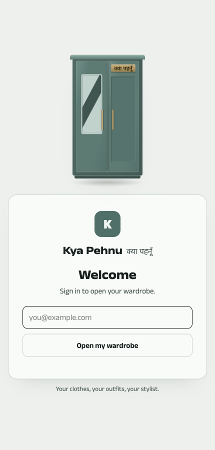
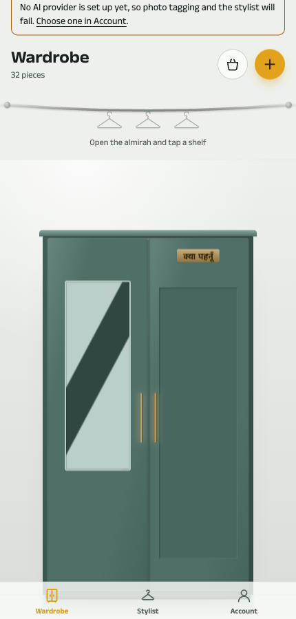
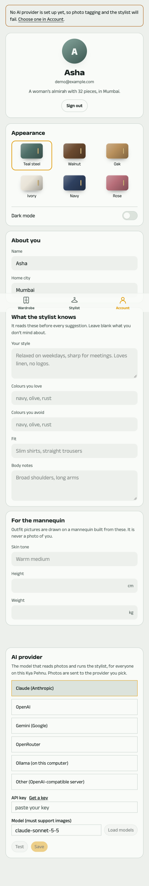

# Kya Pehnu (क्या पहनूँ — "what do I wear?")

A personal styling agent you run yourself. Photograph your clothes, and a vision AI tags each garment and builds a digital wardrobe. Then it plans outfits for the day, the weather and the occasion, and you can chat with a stylist that knows what you own. MIT licensed.

**Bring your own key.** Nothing ships with an AI key and nothing is hosted for you. You run three containers on your computer (web app, API, Valkey), paste your own Claude, OpenAI, Gemini, OpenRouter key (or point it at a local Ollama), and your photos go only to the provider you chose.

  

## Quick start

Needs Docker Desktop (or Docker Engine) with **Compose 2.23+** and ~3 GB of disk (the background-removal model is baked into the image).

```sh
git clone <this repo> kyapehnu && cd kyapehnu
./setup.sh                              # writes .env with a random Valkey password
docker compose up -d --build --wait     # first build takes a few minutes
```

Open <http://localhost:8080>, enter any email (no Google, no password: it only names your account on this computer), then **Settings → AI provider**, pick a provider, paste your key, choose a model, Save. Add photos in **Add items**.

Prefer no clicking? Put the key in `.env` (`ANTHROPIC_API_KEY=`, or `KYAPEHNU_LLM_PROVIDER=openai_compatible` plus `KYAPEHNU_OPENAI_*`) before `up`.

| Provider | What you need |
|---|---|
| Claude | key from console.anthropic.com |
| OpenAI | key from platform.openai.com. Also makes a clean picture of each garment you upload (image generation, a few cents each). |
| Gemini / OpenRouter | their keys, via the OpenAI-compatible endpoint |
| Ollama | runs on your computer, no key: base URL `http://host.docker.internal:11434/v1`, model e.g. `qwen2.5vl:7b` |

## Day to day

- Stop: `make down`. Logs: `make logs`. Data lives in the Docker volume `kyapehnu-data` (`docker compose down -v` deletes it).
- Back up: `make backup`, then `docker compose cp backend:/data/backups/<file>.zip .`. The archive holds no API key.
- Demo wardrobe: `docker compose exec backend kyapehnu seed --email you@example.com`.
- Time zone and city: `TZ=` in `.env` (default `Asia/Kolkata`), home city in Settings.

## Sharing it online (optional)

The default sign-in is email-only and **must stay on your own computer**: the app refuses to start with it on a non-loopback `KYAPEHNU_PUBLIC_URL`. To put it online, set `KYAPEHNU_DEV_LOGIN=0`, `KYAPEHNU_PUBLIC_URL=https://your.domain`, and create a Google OAuth web client (redirect URI `<public url>/api/auth/google/callback`) whose id and secret go in `KYAPEHNU_GOOGLE_CLIENT_ID` / `KYAPEHNU_GOOGLE_CLIENT_SECRET`. Put your own HTTPS reverse proxy in front. The first account is the admin and the only one who sets the AI provider.

## Development

`make dev` (host servers + Valkey in Docker), `make test`, `make lint`, `make typecheck`. Backend: Python 3.12 + FastAPI + SQLite (`services/backend/kyapehnu`). Frontend: React + Vite (`services/frontend`). Architecture decisions: `docs/adr/`. Ops notes: `docs/operations.md`.

## Privacy

Photos and chats stay in your Docker volume. The AI provider you pick sees the images and messages it needs; weather comes from Open-Meteo (city name only). No telemetry.
