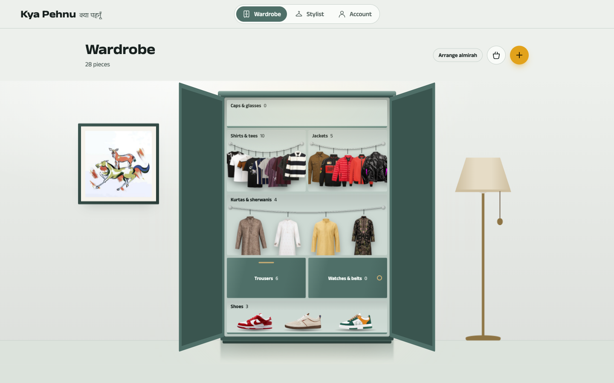
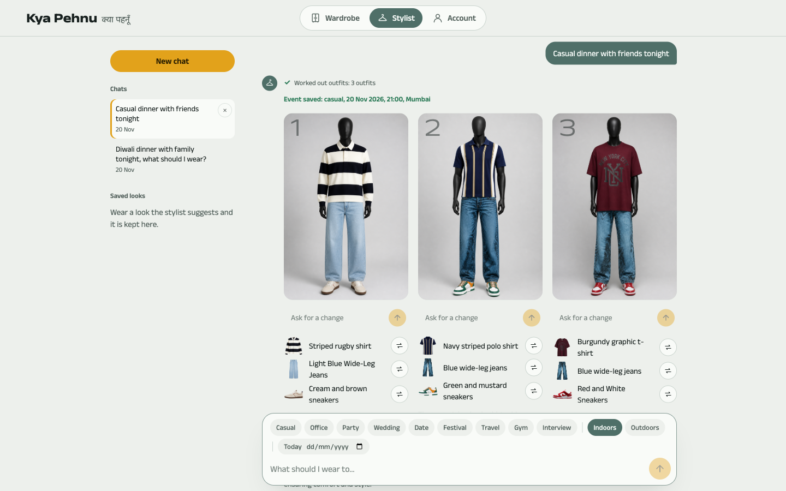
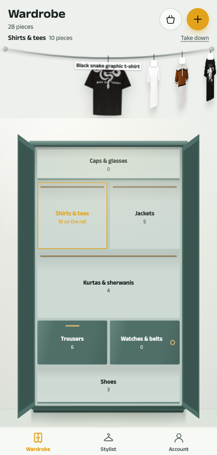
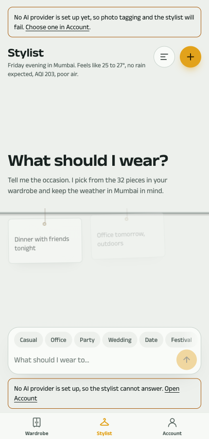
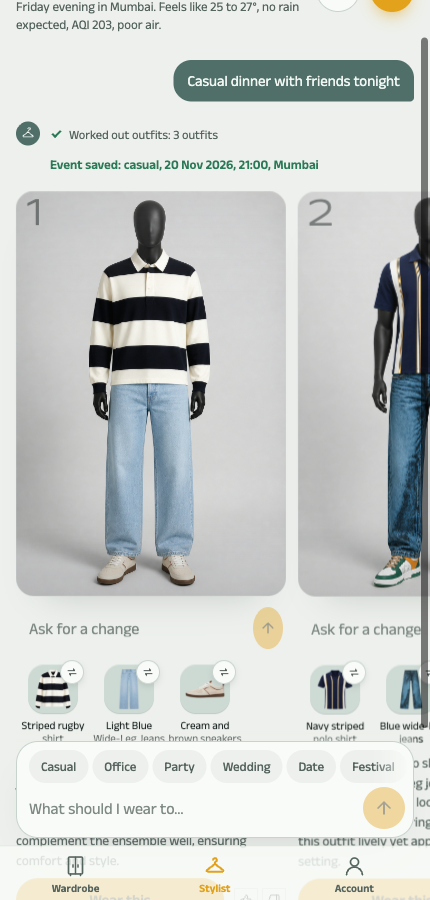
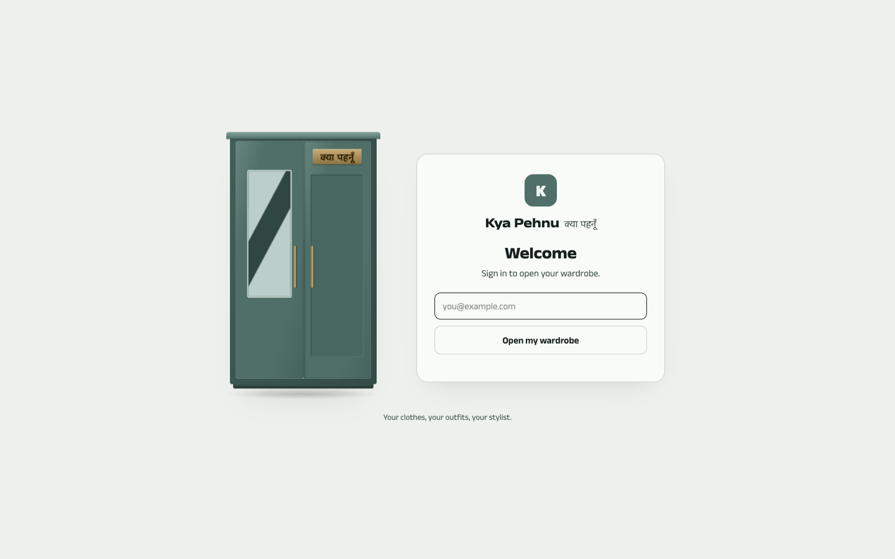
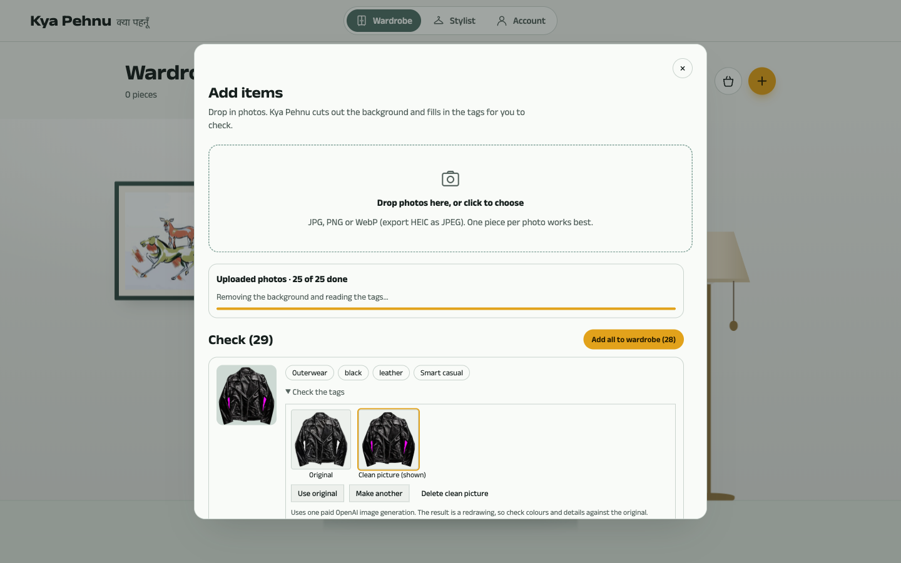
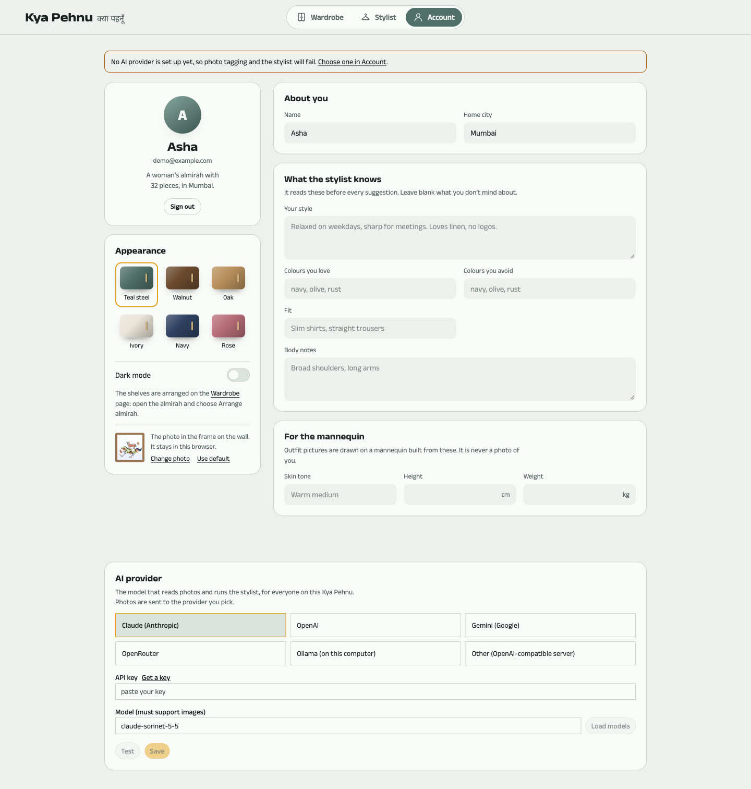

<div align="center">

# Kya Pehnu · क्या पहनूँ

**"What do I wear?" — a personal stylist that knows what is actually in your almirah.**

Photograph your clothes. A vision AI tags every piece and builds your digital wardrobe. Then it plans outfits for the weather and the occasion, and you can chat with a stylist that only suggests things you own.

Self-hosted · Bring your own AI key · MIT licensed



</div>

---

## Demo

[](https://github.com/suraj-singh-sde/kya-pehnu/blob/main/docs/demo/kya-pehnu.mp4)

**[▶ Watch the demo video](https://github.com/suraj-singh-sde/kya-pehnu/blob/main/docs/demo/kya-pehnu.mp4)**: sign in, open the almirah, ask the stylist, get outfits on a mannequin.

| Almirah | Stylist chat | Outfits on a mannequin |
|---|---|---|
|  |  |  |

<details>
<summary>More screenshots (desktop)</summary>

| | |
|---|---|
|  |  |
|  |  |

</details>

## What it does

- **Digital almirah.** Upload photos of your clothes (many at once). Each garment is cut out, tagged (type, colour, pattern, fabric, dress level, season) and placed on a shelf. Review and fix tags before anything is saved.
- **Outfits.** Pick an occasion, a day and a city. Rules choose the combinations that work (top, bottom, shoes, layers for the weather); the AI picks from numbered candidates and explains the pick.
- **Stylist chat.** Ask in plain words: "Casual dinner with friends tonight", "something for a wedding on Saturday". It uses your wardrobe and the local weather, and never tells you to buy something.
- **Mannequin view.** Every outfit is drawn on a mannequin from your own pieces.
- **Weather aware.** Forecast from Open-Meteo, by city name only.
- **Your data stays with you.** SQLite and image files live in a Docker volume on your machine. No account, no cloud, no telemetry.

## Bring your own key

Nothing ships with an AI key and nothing is hosted for you. You paste your own key and your photos go only to the provider you choose.

| Provider | What you need |
|---|---|
| **Claude** | A key from [console.anthropic.com](https://console.anthropic.com) |
| **OpenAI** | A key from [platform.openai.com](https://platform.openai.com). Also generates a clean picture of each garment (image generation, a few cents per item). |
| **Gemini / OpenRouter** | Their key, via the OpenAI-compatible endpoint |
| **Ollama** | Runs on your computer, no key. Base URL `http://host.docker.internal:11434/v1`, model e.g. `qwen2.5vl:7b` |
| **Any OpenAI-compatible server** | Base URL, key and a vision-capable model |

The model must be able to read images. **Settings → AI provider** checks this when you save and shows "Works: this model can read photos".

## Quick start

**You need:** Docker Desktop (or Docker Engine) with Compose 2.23+, and about 3 GB of disk (the background-removal model is baked into the image).

```sh
git clone https://github.com/suraj-singh-sde/kya-pehnu.git
cd kya-pehnu
./setup.sh                              # writes .env with a random Valkey password
docker compose up -d --build --wait     # first build takes a few minutes
```

1. Open <http://localhost:8080>.
2. Enter any email. There is no password and no Google needed: the email only names your account on this computer.
3. **Settings → AI provider**: choose a provider, paste your key, pick a model, **Save**.
4. **Add items**: drop in photos of your clothes, review the tags, approve.
5. Open the **Stylist** tab and ask what to wear.

Prefer no clicking? Put the key in `.env` before `up`: `ANTHROPIC_API_KEY=...`, or `KYAPEHNU_LLM_PROVIDER=openai_compatible` with `KYAPEHNU_OPENAI_BASE_URL`, `KYAPEHNU_OPENAI_API_KEY` and `KYAPEHNU_OPENAI_MODEL`. See [`.env.example`](.env.example) for every option.

If port 8080 is busy, set `KYAPEHNU_PORT=8090` in `.env`.

## How it works

```
 browser ──► nginx (frontend, :8080) ──► FastAPI backend ──► your AI provider
                                              │   │
                                         SQLite   Valkey
                                      (+ images)  (sessions)
```

Three containers: `frontend` (React + Vite served by nginx), `backend` (FastAPI, SQLModel, SQLite) and `valkey` (sign-in sessions).

- **Local-first photo handling.** Segmentation and background removal run on your machine. Only the cut-out garment goes to the AI.
- **Rules decide, the model chooses.** Code builds the valid outfit candidates; the model picks among numbered ones, so it cannot invent clothes you do not have ([ADR 0006](docs/adr/0006-rules-decide-model-picks-numbered-candidates.md)).
- **The model sees allow-listed views** of your data, not the database ([ADR 0012](docs/adr/0012-model-sees-allow-listed-views.md), [ADR 0007](docs/adr/0007-what-is-sent-to-the-ai-provider.md)).

All design decisions are in [`docs/adr/`](docs/adr/).

## Day to day

| Task | Command |
|---|---|
| Start | `docker compose up -d` |
| Stop | `make down` |
| Logs | `make logs` |
| Back up | `make backup`, then `docker compose cp backend:/data/backups/<file>.zip .` (no API key inside) |
| Demo wardrobe | `docker compose exec backend kyapehnu seed --email you@example.com` |
| Wipe everything | `docker compose down -v` (deletes the `kyapehnu-data` volume) |

Time zone and city: `TZ=` in `.env` (default `Asia/Kolkata`); home city in Settings.

## Share it online (optional)

The default email-only sign-in **must stay on your own computer**. The app refuses to start with it on a non-loopback `KYAPEHNU_PUBLIC_URL`.

To host it for other people:

1. Set `KYAPEHNU_DEV_LOGIN=0` and `KYAPEHNU_PUBLIC_URL=https://your.domain`.
2. Create a Google OAuth web client with redirect URI `<public url>/api/auth/google/callback`.
3. Put its id and secret in `KYAPEHNU_GOOGLE_CLIENT_ID` and `KYAPEHNU_GOOGLE_CLIENT_SECRET`.
4. Put your own HTTPS reverse proxy in front.

The first account is the admin and the only one who sets the AI provider. Details: [`docs/operations.md`](docs/operations.md).

## Development

```sh
make dev         # host servers + Valkey in Docker
make test        # backend tests (pytest)
make lint
make typecheck
```

- Backend: Python 3.12, FastAPI, SQLModel, SQLite, `uv`, `ruff`, `mypy --strict`, `pytest` (`services/backend/kyapehnu`)
- Frontend: React, Vite, TanStack Query; API types generated with `npm run gen:api` (`services/frontend`)

## Privacy

Photos and chats stay in your Docker volume. The AI provider you pick sees the images and messages it needs to answer, under its own terms. Weather comes from Open-Meteo (city name only). No telemetry, no analytics.

Your API key is not included in backups and is sent only to your provider.

## Contributing

Issues and pull requests are welcome. Run `make lint typecheck test` before opening a PR. For a larger change, open an issue first.

## License

[MIT](LICENSE)
